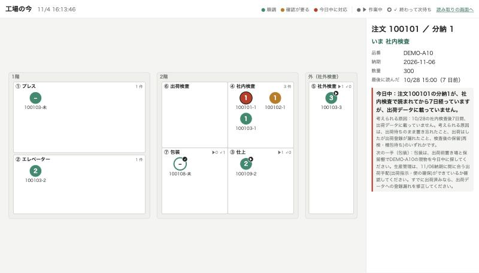

# 検査場タグ

町工場で、作った製品の分納が「いまどこにあるか」を、カードをかざすだけで残すしくみです。
Claude が読み取りの履歴と生産管理データの食い違いを見て、原因の見立てと次に誰へ何を確かめるかを日本語で出します。

すべて Built with Claude: Japan 2026 の期間中（2026-11-02 12:00 以降）に新しく書いたものです。



## なぜ作ったか

検査が終わった製品は、出荷されるまで生産管理データに現れません。
プレスで作り、社内や社外（内職さん）で検査し、包装して出荷する。その間どこに何があるかは、人の記憶にしかありませんでした。

各工程に置くのは小さな読み取り機だけです。モニターもパソコンも要りません。
記録票と一緒にカゴへ入れたカードをかざすと、工程と時刻が残ります。

## しくみ

| 工程 | すること |
|---|---|
| ① プレス | 記録票の QR を読み、続けてカードをかざす。注文番号とカードが紐付く |
| ② エレベーター | カードをかざすと分納番号を自動で振り、読み取り機の画面いっぱいに出す。記録票に書き写す |
| ③ 仕上 | 開始と終了でかざす |
| ④ 社内検査 | 検査が終わったらかざす。ここを「いま何があるか」の基準にする |
| ⑤ 社外検査 | 内職さんに渡す日に開始、納品で受け取ったら終了。どちらも社内でかざす。誰に渡したかは内職依頼に入れる |
| ⑥ 出荷検査 | 開始と終了でかざす |
| ⑦ 包装 | 開始と終了でかざす |

- 開始か終了かはボタンで選びません。1回目が開始、開始のあとが終了です。間違えて終了にしても、もう一度かざせば開始に戻ります。
- 10秒以内の二度読みは数えません。
- 社外検査の間は、運んでいる途中も内職さんの所にある間も「外にある」とみなします。内職さんにリーダーは渡さず、社内のネットワークにもつなぎません。

### 内職依頼

内職さんは何人もいるので、誰に、どの分納を、いつまでに渡したかが要ります。現場では AppSheet の内職依頼に、記録票の QR を読んで注文番号を入れ、数量・分納番号・内職さんへの納期を手で入れています。

社外検査でカードをかざすと、その分納が「依頼の入力待ち」に出ます。入力では内職さんを選び、出てきた分納を押して納期を入れるだけです。注文番号・分納番号・数量は打ちません。

- 本番の正本は AppSheet の内職依頼です。AppSheet は内職さんごとのグループから入力を始めるので、担当は選ばずに済みます。kensa-tag は「かざしたのに依頼が無い分納」の一覧を出し、AppSheet のフォームはそれを選ぶだけにする想定です（未実装）。kensa-tag から内職依頼には書き込みません。
- デモでは同じ動きの画面 `/naishoku` を持ち、依頼を kensa-tag の中の表に入れます。
- 工場図の社外検査の区画は、内職さんごと・依頼の入力待ち・納品済みに分かれます。
- 使用中のカードを別の注文に付け替えようとすると、黄色で「使用中」と警告します。3秒以上置いてもう一度かざしたときだけ付け替えます。
- 連絡票（出荷データ）に載ったら紐付けを閉じ、カードを使い回します。分納番号は使い回しません。
- 数量は翌日の生産日報が入るまで「未定」と出します。

記録は「いつ・どの工程で・開始か終了か・どの端末が読んだか」の履歴だけを持ち、いまの状態は履歴から計算します。タグには何も書き込まず、UID を読むだけです。

工程は `app/flow.json` の一覧で持ちます。工程を足すのは、このファイルに1行足すだけです（`FLOW_FILE` で別のファイルも指定できます）。

## Claude の見立て

検出そのものは決まった処理で行い、その結果を Claude に渡します。

| 検出 | 内容 |
|---|---|
| かざし忘れ | 出荷データに載っているのに、社内検査の読み取りがない |
| 滞留 | 社内検査で読んだのに、何日も出荷データに載らない。内職さんの所にある間は数えず、納品の日から数え直す |
| 数量の照合 | 生産数と包装の計量が合わない |
| 分納の合計 | 完納なのに、分納の合計が注文数と合わない |
| 内職依頼の入力待ち | 社外検査に渡した翌日になっても、内職依頼が無い |
| 内職さんの納期切れ | 内職さんへの納期を過ぎても、納品でかざされていない |
| 依頼とカードの食い違い | 内職依頼はあるのに、そのカードが社外検査で読まれていない。同じ注文で外に出ている分納も添えるので、分納番号の書き写し違いを疑える |

Claude（`app/triage.py`、モデルは `claude-opus-5-5`）は、同じ原因のまとまり、納期を踏まえた優先順位、次に誰へ何を確認するかを返します。どれもタグの履歴と生産管理データの両方がそろって初めて分かることです。

返事には20〜30秒かかります。検出結果が変わったときだけ裏で聞き直し（`app/auto_triage.py`）、画面には保存済みの見立てをすぐ出します。止めるときは `AUTO_TRIAGE=0` を設定します。

## 画面

- `/board` 工場の図。分納1つを点にして、最後に読んだ工程の区画に置きます。2秒ごとに読み直し、かざすと点が次の区画へ動いて光ります。
  - 色は急ぎ具合です。緑が順調、黄が確認が要るもの、赤が Claude が「今日中」と見立てたものです。
  - 開始したものは塗りつぶしに ▶、終わって次を待つものは白抜きに ✓ です。
  - 点を押すと、右に詳しいことと Claude の見立てを出します。
  - 区画の位置は `app/flow.json` の `zone` と `map` で決めます。図は実際の配置を簡略化したものです。
- `/` 読み取りの画面。USB 版の読み取り機をつないだ端末で使います。「調べる」で記録票の QR を読むと、記録はせずに分納ごとの現在地を出します。
- `/naishoku` スマホ向けの内職依頼の入力。内職さんを選び、さっきかざした分納を押して納期を入れます。
- `/t/カードの番号` スマホ向けに、カードの中身と同じ注文の分納を出します。

## 動かす

[uv](https://docs.astral.sh/uv/) を使います。架空のデータを作ってからサーバーを起動します。

```bash
uv run python demo/seed.py
```

```bash
uv run uvicorn app.main:app --host 0.0.0.0 --port 18300 --env-file ~/.kensa-tag.env
```

`http://localhost:18300/board` を開きます。

Claude に見てもらうには、リポジトリの外の `~/.kensa-tag.env` に `ANTHROPIC_API_KEY=...` を書きます。キーが無くても、読み取りと検出は動きます。

```bash
uv run pytest
```

## 読み取り機

AtomS3R ＋ Unit RFID2 ＋ Atomic QRCode2 Base を1台にまとめ、QR もカード（NTAG213）も読みます。ファームは `firmware/`（PlatformIO）にあり、2種類あります。

| env | 使い方 |
|---|---|
| `atoms3r-wifi` | 現場用。読み取りをサーバーへ直接送り、結果を本体の画面に出す |
| `atoms3r` | USB キーボードとして、読んだ中身と Enter をつないだ端末に打ち込む |

Wi-Fi 版のつくり:

- 本体は時計を持たず、読んでから送るまでの経過時間（`age_ms`）を送ります。時刻はサーバーが付けます。
- 送れなかった読み取りは本体にためて、つながったら順番どおり送り直します。工場の LAN が時々詰まっても読み取りを捨てません。
- サーバーは `名前.local`（mDNS）で探し、見つからなければ IP を使います。DNS は使いません。
- Wi-Fi は2つまで書けて、届く方につなぎます（2.4GHz）。
- 工程は本体ごとに選びます。ボタンを3回続けて押すと一覧が出て、押すと次、長押しで決定します。一覧はサーバーの `app/flow.json` から取ります。

```bash
cp firmware/include/wifi_secrets.example.h firmware/include/wifi_secrets.h
```

`wifi_secrets.h` に Wi-Fi とサーバーを書きます。このファイルは git に入りません。

```bash
cd firmware && pio run -e atoms3r-wifi -t upload
```

## データ

`demo/data/` は架空のデータです。実在の注文・取引先・人は含みません。`demo/record-sheets.pdf` は実演用の架空の生産指示記録票（右上の QR は 20mm 角）で、`demo/record_sheet.py` で作り直せます。

`demo/data/workers.json` は内職さんの呼び名（検査A〜C）です。本番では AppSheet のグループと同じ並びにします。

本番は同じ形の JSON を別のフォルダーに書き出し、`SOURCE_DIR` で指定します。保存先は `DB_PATH` で変えられます。生産管理データは読むだけで、書き込みません。

## ファイル

| 場所 | 中身 |
|---|---|
| `app/main.py` | API と画面の入口（FastAPI） |
| `app/service.py` | 読み取りを受けて履歴を残す。紐付け・分納番号・開始と終了 |
| `app/detect.py` | 7つの検出 |
| `app/naishoku.py` | 内職依頼。入力待ちの分納と、依頼の保存 |
| `app/triage.py` `app/auto_triage.py` | Claude の見立て |
| `app/views.py` | 注文・カード・工場図の中身を履歴から計算 |
| `app/flow.json` | 工程と工場図の区画 |
| `app/static/` | 画面（素の HTML と JavaScript） |
| `firmware/` | 読み取り機のファーム |
| `demo/` | 架空のデータと記録票 |
| `tests/` | テスト |

## ライセンス

MIT（[LICENSE](LICENSE)）
