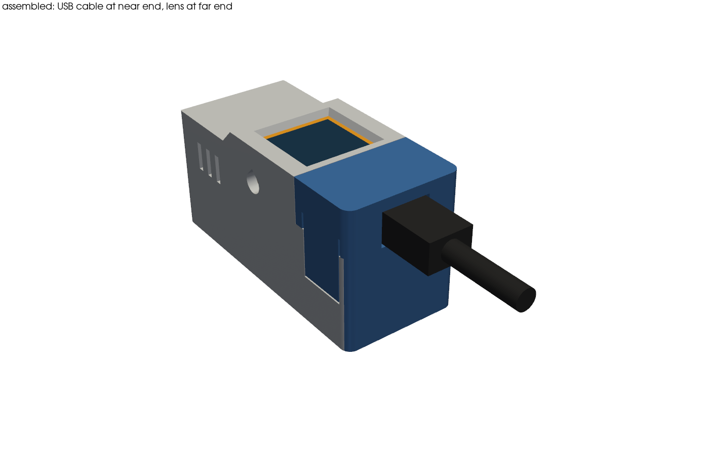

# 読み取り機の筐体（底面読み取り）

AtomS3R、Atomic QRCode2 Base、Unit RFID2 を1つにまとめる3Dプリント筐体です。
RFID2 を本体の真下に置き、底面でカードを読みます。外形は幅 29.2 × 長さ 67.6 × 高さ 34.4 mm です。AtomS3R が QR Base より 3.5 mm 高いので、天板も画面側を高くして、前へ45度で下げています。



前端で QR を読み、底面をカードに当てて読みます。画面は上面なので、カードに当てている間も見えます。

寸法の出典と、実機で測る項目は [DIMENSIONS.md](DIMENSIONS.md) にあります。部品の主な寸法は実測済みです。2026-11-03 に試し刷りし、組み立てと筐体越しのカード読み取りを確かめました。部品の収まりはかなりきついので、次の版でゆるめる予定です。

## 部品表

| 部品 | 数 | 備考 |
|---|---|---|
| `tray.stl`（本体） | 1 | 印刷する |
| `cap.stl`（後ろのふた） | 1 | 印刷する |
| AtomS3R | 1 | |
| Atomic QRCode2 Base | 1 | |
| Unit RFID2 | 1 | |
| Grove ケーブル | 1 | 付属の 20 cm は約 2.3 周丸めて収める。短いケーブルがあれば、そのほうが楽 |
| USB-C ケーブル | 1 | プラグ幅 11 mm、厚さ 7.5 mm まで（通し穴は 12.2 × 8.4 mm） |

ネジは使いません。アンテナの近くに金属を増やさないためです。

## 印刷

- FDM、PLA、ノズル 0.4 mm、積層 0.2 mm
- STL は印刷の向きで出してあるので、回さずに置く
- サポートなし。45度より寝た下向き面はブリッジで刷る
  - `tray`: 天板の裏（幅 24.4 mm）、爪の窓の上（10 mm）、通気の切り込みの上（1.6 mm）、刻印の底（0.8 mm）
  - `cap`: USB の通し穴の縁（12.2 mm）、爪の段（0.6 mm）
- `cap` の2本の足は約 30 mm の細い柱になる。倒れるようならブリムを付ける

## 組み立て

1. AtomS3R を QR Base に載せる
2. RFID2 の表を下、Grove の口を後ろに向けて、`tray` の下の段へ奥まで滑らせる
3. 本体を上の段のレールに載せて、奥まで滑らせる
4. Grove ケーブルを両方に挿し、余りを後ろの空間で丸める。USB-C の下に収める
5. `cap` を上から押して、左右の爪をはめる。足が本体と RFID2 の抜け止めになる
6. USB-C ケーブルを後ろの穴から挿す

ふたを閉めたまま USB-C を抜き差しできます。リセットは左側面（USB-C を手前にして見て左）の穴から細い棒で押します。ファームの書き換えで分解は要りません。

QR Base には物理ボタンがありません。読み取りの開始はファームから TRIG ピンで行います。

## 作り直す

```bash
uv run --no-project --python 3.12 --with cadquery --with trimesh --with numpy --with scipy --with networkx --with rtree --with manifold3d --with pyvista --with shapely python build_case.py
```

確認と画像も同じ形で実行します。

| スクリプト | 内容 |
|---|---|
| `build_case.py` | STL と STEP を出す。寸法はすべて冒頭の定数 |
| `check_case.py` | 干渉、入れる経路、視野、配線の通り道、壁厚、閉じた立体か、張り出しを計算で確かめる |
| `render_case.py` | `renders/` に組み立て図、分解図、断面図、印刷の向きを出す |

`check_case.py` の部品は単純な箱です。実際の形との差は確かめられません。

## 試し刷りの結果（2026-11-03）

1回目を刷って組み立てられた。筐体に入れたまま、底面越しにカードを読めた。サポートが要った所で寸法が変わり、かなりきつい。今はこの版で進める。直すときは、サポートが要った所を聞いてから `FIT` や形を見直す。

## 実機で最初に確かめること

1. 筐体に入れて、カードが底面越しに読めるか
2. 本体と RFID2 が奥まで滑り込むか
3. Grove ケーブルの余りが収まり、ふたが閉まるか
4. 爪のはまり具合。きつければ `FIT` と爪の張り出しを直す
5. 太い USB プラグがふたの穴を通るか
